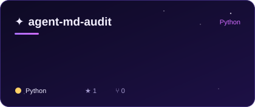
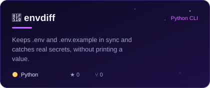
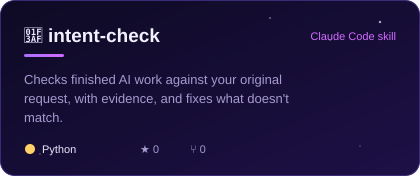
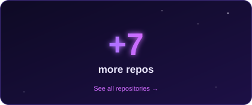
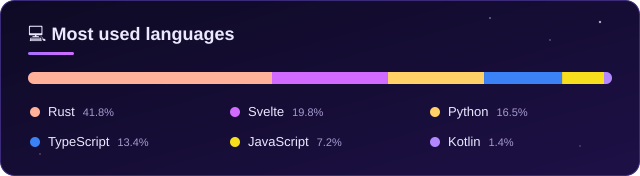
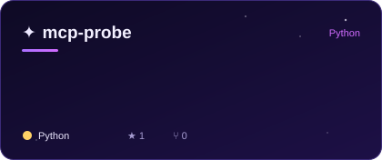
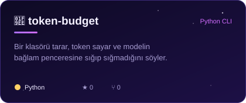
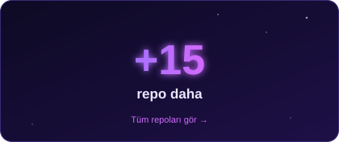
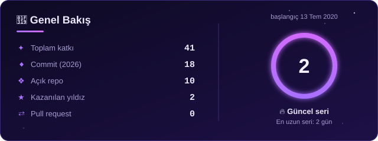
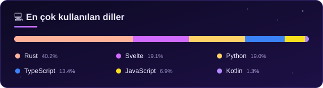

 

<a href="#-english"><b>English</b></a> &nbsp;·&nbsp; <a href="#-türkçe"><b>Türkçe</b></a>

## 🌙 English

I'm a software developer who aims to write **clean, maintainable and reliable** software.
I mostly code in **.NET (C#)**, **Dart** and **Python**, and lately I build small, sharp **CLI tools and AI developer tools**.

### 🚀 Projects

<!-- projects:en:start -->

  
  
  
  

<!-- projects:en:end -->

### 📊 Stats

  
  

Cards are rendered by a GitHub Action in this repo every day, so they never depend on an outside stats service.

## 🌙 Türkçe

**Temiz, sürdürülebilir ve güvenilir** yazılım yazmayı hedefleyen bir yazılım geliştiricisiyim.
Çoğunlukla **.NET (C#)**, **Dart** ve **Python** ile kod yazıyorum; son zamanlarda küçük ve işini iyi yapan **CLI araçları ve yapay zeka geliştirici araçları** üretiyorum.

### 🚀 Projeler

<!-- projects:tr:start -->

  
  
  
  

<!-- projects:tr:end -->

### 📊 İstatistikler

  
  

Kartlar bu repodaki bir GitHub Action ile her gün yeniden çizilir; dışarıdaki bir istatistik servisine bağlı değildir.

